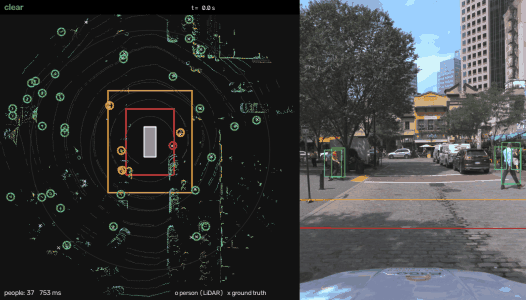
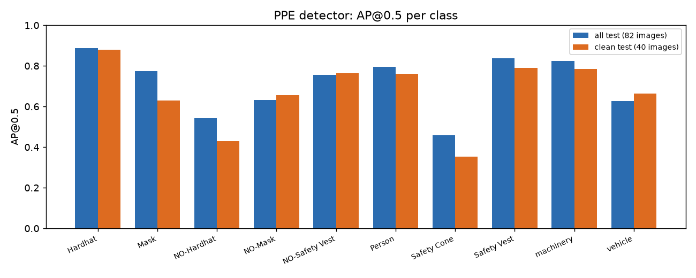
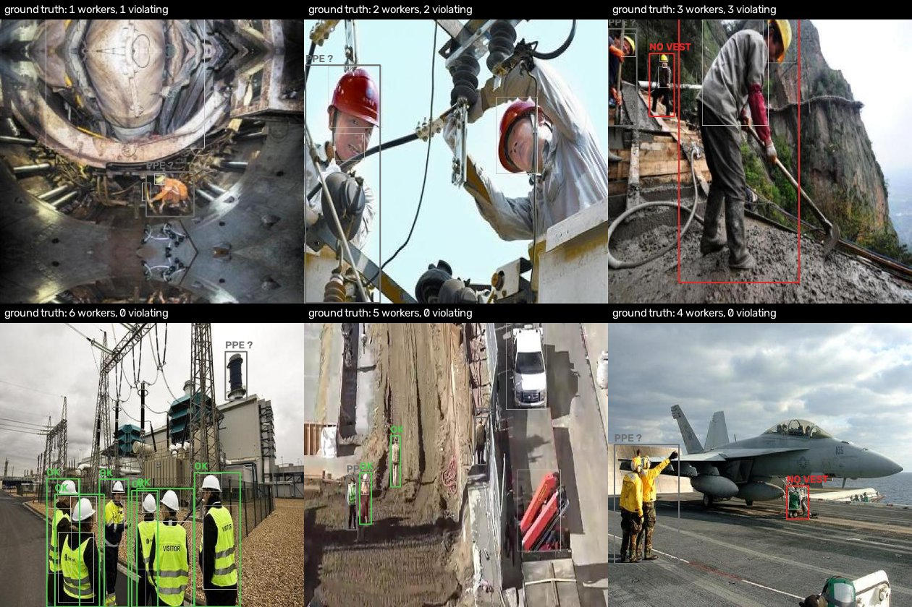
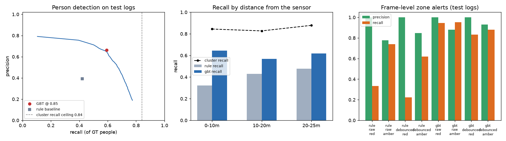
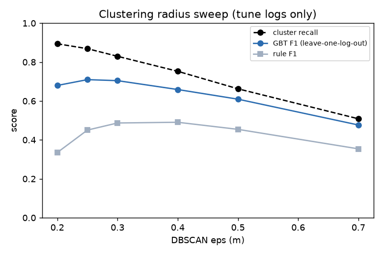
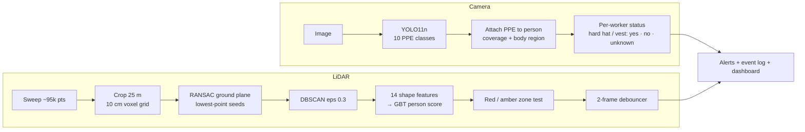

<div align="center">

# 🦺 Construction Site Safety Monitor: camera PPE checks + LiDAR danger zones

**A YOLO11 detector that tells you *which worker* is missing a hard hat or vest, and a classical LiDAR pipeline (RANSAC ground removal → DBSCAN → learned cluster classifier) that raises red/amber alerts when a person enters the danger zone around a machine. Both are measured honestly, including the leakage in the PPE test set and the 18-frame sample behind the red-zone number.**

[](https://github.com/haroonkhan02/construction-safety-lidar-vision/actions/workflows/ci.yml)




<sub>Argoverse 2 test log, 15 s. Left: bird's-eye LiDAR view (people = circles, colour = zone; white × = ground-truth people). Right: the zones and detected people projected into the front camera. The "machine" is the sensor vehicle itself.</sub>

</div>

---

## Highlights

- **Per-worker PPE compliance, not just boxes.** YOLO11n fine-tuned on 10 PPE classes; a small rule engine attaches hard hats and vests to the person wearing them (coverage + body-region checks) and flags violations. The same rules run on the ground-truth boxes, so compliance itself is evaluated.
- **The PPE test set leaks, and I measure it.** The training split is 514 source images exported 5× as mosaics, and **41 of the 82 test images come from videos that also appear in training**. mAP is reported on all 82 and on the **40 clean images**.
- **LiDAR pipeline from first principles.** Voxel grid, RANSAC plane fit, DBSCAN, 14 shape features, gradient-boosted trees. **Plain RANSAC missed the road by more than 0.3 m in 56 % of sweeps (median error 1.2 m)**, because a horizontal band through every wall beats the sparse road; seeding it from the lowest point of each 1 m cell cut the median error to **7 cm**.
- **Chosen on tune logs, tested once.** 12 busy Argoverse 2 logs are split into 6 tune / 6 test logs. The DBSCAN radius and the classifier threshold were picked with leave-one-log-out CV on the tune logs only.
- **Results.** On 2,599 people across 192 test sweeps: person F1 **0.63** (GBT) vs 0.41 (hand rules). Red-zone alerts fired in **17 of 18** occupied frames with **0 false alarms in 174 empty frames** (95 % CI on recall 0.74–0.99). The whole LiDAR pipeline takes **~51 ms per sweep** on an M5 CPU, inside the 100 ms budget of a 10 Hz sensor.

## Results

### 1 · PPE detection (Roboflow Construction Site Safety, test split)

| Test images | mAP@0.5 | mAP@0.5:0.95 | Precision | Recall |
|---|---|---|---|---|
| All 82 (as shipped) | 0.713 | 0.413 | 0.845 | 0.646 |
| **40 clean** (no source image or video shared with training) | **0.671** | **0.384** | 0.844 | 0.615 |
| *Validation, 114 images (best epoch)* | *0.772* | *0.453* | | |

<sub>YOLO11n (2.6 M parameters), COCO-pretrained, 40 epochs at 640 px in 59 min on the Apple M5 GPU; the best validation epoch was the last one, so longer training would probably still help. Latency per 640 px image: 7.9 ms on MPS, 22.5 ms on the M5 CPU. The 4-point mAP drop on the clean images is the leakage effect; the hardest classes are the small ones: NO-Hardhat (0.43 clean) and Safety Cone (0.35 clean). All numbers: `reports/ppe/results_test.json`, audit: `reports/ppe/dataset_audit.json`.</sub>

<p align="center"></p>

### 2 · Per-worker compliance (same test images, detector at confidence 0.35)

| Metric | Value |
|---|---|
| Workers found (ground-truth Person boxes matched at IoU ≥ 0.5) | 127 / 174 = **0.73** (precision 0.88) |
| Hard-hat status agrees with ground truth (matched workers, status known) | 90 / 111 = 0.81 |
| Vest status agrees with ground truth | 100 / 118 = 0.85 |
| **Violation flagging**: precision | 60 / 62 = **0.97** |
| **Violation flagging**: recall (missed workers count as missed) | 60 / 88 = **0.68** |

<sub>The rules are applied identically to ground-truth and predicted boxes. Confidence 0.35 was fixed before evaluation, not tuned on test. Of the 28 missed violations, 17 are workers the detector didn't find and 11 are workers whose NO-Hardhat / NO-Safety Vest box was missed, leaving the status "unknown"; none was wrongly called compliant.</sub>

<p align="center"></p>
<p align="center"><sub>Top row: images with a ground-truth violation. Bottom row: compliant workers. Red = violation (labelled), green = hard hat + vest found, grey = PPE status unknown (item not visible or not detected). Thin boxes are the raw PPE detections.</sub></p>

### 3 · LiDAR person detection (Argoverse 2, 6 test logs, 192 sweeps, 2,599 labelled people within 25 m)

| Classifier | Precision | Recall | F1 |
|---|---|---|---|
| Hand-written rules (height 1.0–2.1 m, footprint ≤ 1.3 m) | 0.391 | 0.422 | 0.406 |
| **Gradient-boosted trees on 14 cluster features** | **0.662** | **0.593** | **0.626** |
| *Ceiling: people with any cluster within 1 m* | | *0.842* | |

<p align="center"></p>

### 4 · Danger-zone alerts (frame level, same test sweeps, GBT)

| Zone | Debounce | Precision [95 % CI] | Recall [95 % CI] | Occupied frames |
|---|---|---|---|---|
| Red (machine + 3 m) | none | 1.00 [0.82, 1.00] | 0.94 [0.74, 0.99] | 18 |
| Red | 2 frames | 1.00 [0.80, 1.00] | 0.83 [0.61, 0.94] | 18 |
| Amber (machine + 6 m) | none | 0.88 [0.81, 0.93] | 0.95 [0.90, 0.98] | 108 |
| Amber | 2 frames | 0.93 [0.87, 0.97] | 0.88 [0.81, 0.93] | 108 |

<sub>All numbers are in `reports/lidar/results_test.json`. Ground-truth occupancy uses labelled people with ≥ 5 LiDAR points. The test frames are 0.5 s apart, so the 2-frame debouncer needs ~0.5 s of persistence here (0.1 s at the full 10 Hz). The rule baseline found only 6 of the 18 red-zone frames.</sub>

### 5 · What the choices are worth (tune logs only, leave-one-log-out)

| Variant | Cluster recall | GBT F1 | Ground error (median) | Plane off by > 0.3 m |
|---|---|---|---|---|
| **Seeded RANSAC, DBSCAN eps 0.3 (chosen)** | **0.830** | **0.705** | **0.069 m** | **0 %** |
| DBSCAN eps 0.5 | 0.663 | 0.609 | 0.069 m | 0 % |
| DBSCAN eps 0.2 | 0.894 | 0.680 | 0.069 m | 0 % |
| Plain RANSAC (no seeding) | 0.605 | 0.524 | 1.225 m | 55.7 % |
| Open3D `segment_plane` | 0.537 | 0.487 | 1.290 m | 59.4 % |

<p align="center"></p>

<sub>Full table: `reports/lidar/ablations_tune.md`. Smaller eps separates people walking together (cluster recall rises) but starts splitting one person into legs and torso, so the classifier's F1 peaks at 0.25–0.3. eps 0.25 and 0.3 tie (0.710 vs 0.705); I kept 0.3, where the rule baseline is also better.</sub>

**Reading the results honestly**
- **Recall is capped by clustering, not by the classifier.** 16 % of people never get their own cluster. Looking at the misses: people merged with a pole, wall or parked car, two people walking together merged into one, and people too sparse after ground removal (far away or occluded). A learned 3D detector (PointPillars / CenterPoint) would do much better in crowds. This pipeline's strengths are that it needs no GPU and every step can be inspected.
- **Zone alerts look better than person detection** because an alert only needs *one* person found in the zone, and people close to the sensor are dense and easy. The hard cases are mostly far away.
- **This is not a construction site.** Argoverse 2 is a car in US city traffic; I treat the car as the machine. The geometry is the same as a LiDAR on an excavator, but construction-specific clutter (scaffolding, rebar, piles of material) is not tested.

## How it works



1. **PPE detection.** YOLO11n (COCO-pretrained) fine-tuned for 40 epochs at 640 px on the Apple M5 GPU (MPS).
2. **Compliance rules.** A PPE box belongs to the person box that covers ≥ 60 % of it. A hard hat must sit in the top 45 % of that person, a vest's centre between 15 % and 85 % of the height. NO-Hardhat / NO-Safety Vest boxes mark violations; masks are reported but not part of the rule.
3. **Ground removal.** RANSAC samples only points within 20 cm of the lowest point of their 1 m × 1 m cell, rejects planes tilted > 15°, then refits by least squares (SVD). Points 0.15–2.5 m above the plane are kept.
4. **Clustering.** DBSCAN (Open3D, scikit-learn fallback) with eps 0.3 m, min 8 points.
5. **Person classifier.** Height, bottom, extents, PCA footprint, planarity/linearity, density, range and intensity → `HistGradientBoostingClassifier`, trained on tune-log clusters labelled by the person cuboid that contains most of their points; threshold 0.85 from grouped (by log) cross-validation.
6. **Zones and alerts.** The machine body is a 5 × 2 m rectangle; red = body + 3 m, amber = body + 6 m. An alert starts after 2 consecutive occupied frames and is logged to `alerts.jsonl` with the closest distance.

## Repository structure

```text
construction-safety-lidar-vision/
├── src/sitesafety/
│   ├── download.py         # Kaggle PPE set; Argoverse 2 logs over public S3 (log ranking by people nearby)
│   ├── ppe_data.py         # dataset audit: class counts, YOLO YAML, source/video leakage, dHash
│   ├── train_ppe.py        # YOLO11n fine-tuning (Ultralytics, MPS/CUDA/CPU)
│   ├── compliance.py       # person ↔ PPE association rules, per-worker status, matching
│   ├── evaluate_ppe.py     # mAP (all / clean test), compliance metrics, latency, gallery
│   ├── detect_image.py     # PPE compliance on images, folders or videos
│   ├── av2.py              # Argoverse 2 reader: sweeps, cuboids, camera calibration
│   ├── pointcloud.py       # crop, voxel grid, RANSAC (seeded / naive / Open3D) ground removal
│   ├── clustering.py       # DBSCAN and 14 cluster shape features
│   ├── lidar_detect.py     # sweep pipeline, rule + GBT cluster classifiers, classifier training
│   ├── zones.py            # danger zones, distances, debouncer
│   ├── evaluate_lidar.py   # detection, cluster recall, zone alerts, ground error, timing
│   ├── ablations.py        # eps / ground-method sweep on the tune logs (leave-one-log-out)
│   ├── visualize.py        # bird's-eye view, camera projection, compliance drawing
│   ├── demo.py             # alert dashboard video, GIF and event log
│   ├── plots.py            # report figures
│   ├── geometry.py         # quaternions, oriented boxes, pinhole projection
│   └── config.py           # YAML config with dotted overrides, device choice
├── configs/default.yaml    # every parameter, with comments
├── tests/                  # 30 unit tests on synthetic clouds and boxes (no data, GPU or Open3D)
├── reports/                # results JSON/CSV/MD and figures from the runs below
├── assets/demo.gif
└── .github/workflows/ci.yml
```

## Getting started

```bash
git clone https://github.com/haroonkhan02/construction-safety-lidar-vision.git
cd construction-safety-lidar-vision
uv venv --python 3.12 && source .venv/bin/activate
uv pip install -e ".[camera,open3d,dev]"
```

**Camera / PPE** (needs a Kaggle API token in `~/.kaggle/kaggle.json`; 206 MB):

```bash
cs-download-ppe              # -> data/ppe/css-data
cs-check-ppe                 # audit + data/ppe/ppe.yaml -> reports/ppe/dataset_audit.json
cs-train-ppe                 # ~1 h on an Apple M5 (MPS); --set ppe.epochs=5 for a quick run
cs-eval-ppe                  # -> reports/ppe/results_test.json, figures
cs-detect path/to/images_or_video.mp4
```

**LiDAR** (no account needed; ~670 MB for 12 logs):

```bash
cs-download-lidar            # ranks the 150 AV2 val logs, downloads 12 (6 tune / 6 test)
cs-ablate-lidar              # eps + ground-method sweep on tune logs (~10 min)
cs-train-lidar               # GBT cluster classifier on the tune logs (~40 s)
cs-eval-lidar                # -> reports/lidar/results_test.json (~30 s)
cs-demo                      # -> outputs/demo/demo.mp4, alerts.jsonl, assets/demo.gif
cs-plots
```

Every parameter lives in `configs/default.yaml` and can be overridden, e.g. `cs-eval-lidar --set lidar.cluster.eps=0.5`.

## Design decisions

- **Rules on top of a detector, instead of "worker-without-hard-hat" classes.** The dataset already labels PPE items and their absence separately. Attaching them to people with explicit geometry is explainable ("this NO-Hardhat box sits on this person's head"), testable, and lets the same code score the ground truth.
- **Report the clean test subset.** Frames from one video are near-duplicates. Splitting by frame inflates test scores, so the 40 test images with no source or video overlap with training are reported separately.
- **Classical LiDAR instead of a deep 3D detector.** It runs on a laptop CPU at 10 Hz and each failure can be traced to a step (ground, clustering or classification). The cost is recall in crowds, which the cluster-recall ceiling makes visible.
- **Open public data, no click-through licences.** KITTI and most construction LiDAR sets need registration. Argoverse 2 is downloadable over HTTPS from its public S3 bucket (CC BY-NC-SA 4.0), with people, signallers and construction cones in its labels.
- **Frame-level alert metrics with confidence intervals.** That's what a machine operator experiences. With only 18 red-zone frames, the interval says more than the point estimate.

## Privacy & ethics

- **Monitoring workers is surveillance.** In the EU/UK, camera monitoring of employees needs a legal basis, a documented purpose, a data-protection impact assessment and usually consultation with workers or their representatives. Use it to protect people (alert the operator, improve the site), not to discipline individuals automatically.
- **Minimise data.** Both halves can run on the device and store only events (time, zone, distance, violation type) without images or identities. LiDAR is more privacy-friendly than video: a point cloud doesn't show faces.
- **Errors are not symmetric.** A missed person in a red zone can be fatal; a false alarm costs time and erodes trust. This prototype is **not a safety-certified system** (cf. ISO 13849 / IEC 61508 for safety functions on machinery) and must never replace physical guarding, spotters or proximity sensors.
- **Bias.** The PPE images are mostly daylight scenes found online. Detection on other clothing, darker lighting, different skin tones or hard-hat colours is not measured. Argoverse 2 people are pedestrians in US cities, not workers bending or kneeling next to machinery.
- **Licences.** Argoverse 2 is CC BY-NC-SA 4.0 (non-commercial); the PPE set is CC BY 4.0; Ultralytics YOLO is AGPL-3.0, so a closed-source product built on it needs an Enterprise licence. Datasets and weights are not redistributed here.

## Testing

```bash
pytest -q        # 30 tests, ~3 s: synthetic point clouds and boxes, no dataset, GPU or Open3D
ruff check .
```

CI runs lint and tests on Python 3.10–3.12 without Open3D or Ultralytics (DBSCAN falls back to scikit-learn).

## Future work

- A learned 3D detector (PointPillars on AV2) as a stronger baseline, and fusion with the clusters
- Tracking (Kalman filter on cluster centroids) to warn about people *walking towards* the zone, plus event-level alert metrics with latency
- Sector-wise ground fitting (Patchwork++) for ramps and uneven sites
- Camera ↔ LiDAR fusion: run the PPE check only on people inside the red zone
- Real construction-site data: a LiDAR + camera recording on an actual machine

## Acknowledgements

[Construction Site Safety](https://universe.roboflow.com/roboflow-universe-projects/construction-site-safety) (Roboflow Universe, CC BY 4.0; [Kaggle mirror](https://www.kaggle.com/datasets/snehilsanyal/construction-site-safety-image-dataset-roboflow)) · [Argoverse 2](https://www.argoverse.org/av2.html): Wilson et al., NeurIPS Datasets & Benchmarks 2021 (CC BY-NC-SA 4.0) · [Ultralytics YOLO11](https://github.com/ultralytics/ultralytics) (AGPL-3.0) · [Open3D](https://www.open3d.org/) · Fischler & Bolles, *Random Sample Consensus*, CACM 1981 · Ester et al., *DBSCAN*, KDD 1996 · Zermas et al., *Fast segmentation of 3D point clouds* (lowest-point-representative ground seeds), ICRA 2017

## License

[MIT](LICENSE) © Muhammad Haroon Khan (code only; datasets and model weights keep their own licences)
